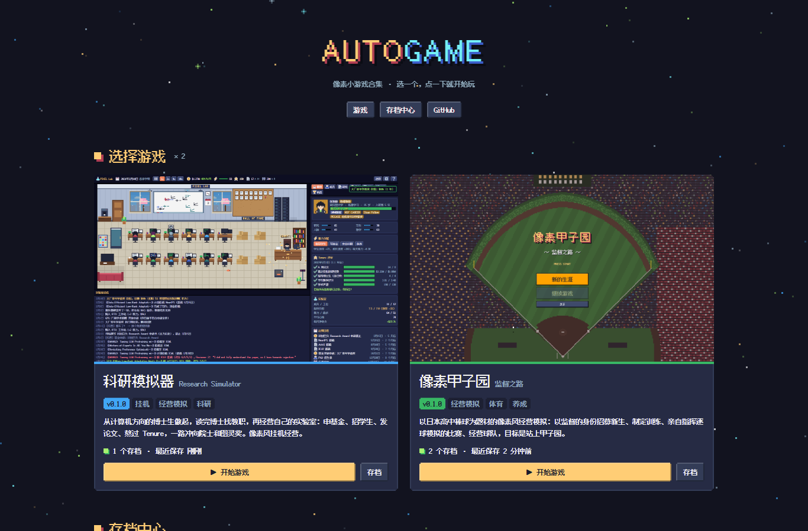

# AutoGame · 像素游戏厅

像素风小游戏合集。打开网页、挑一个游戏、点一下就开始玩；所有游戏的存档在同一个地方管理。

### 👉 <https://yichics.github.io/AutoGame/>



## 游戏

| 游戏 | 版本 | 简介 |
| --- | --- | --- |

## 存档

- 存档自动保存在浏览器本地，下次打开接着玩。
- 首页的**存档中心**可以按游戏单独导出 / 导入，也可以一次性导出 / 导入全部游戏的存档——换设备、换浏览器、清理浏览器数据之前导出一份，到新地方导入即可。
- 游戏里屏幕左边缘有一个小标签，随时回到游戏厅或跳到这个游戏的存档管理。

## 开发

- **更新规则（必读）**：不直接修改 main。每次更新某个游戏，从 main 拉一个 `<游戏id>-v<版本号>` 分支（如 `pixel-baseball-v0.2.0`），在分支上改完再合并回 main；改游戏厅本身用 `hub-v<版本号>`。详见 [CONTRIBUTING.md](CONTRIBUTING.md)。
- **框架说明**：目录结构、`game.json` 字段、存档包格式、悬浮标签——见 [docs/architecture.md](docs/architecture.md)。
- **本地预览**（需要 Node.js 20+）：`node scripts/serve.mjs`，打开 <http://localhost:8080/AutoGame/>。
- **检查**：`node scripts/check.mjs`。
- clone 之后运行一次 `git config core.hooksPath .githooks`，启用防止直接提交到 main 的钩子。

## 目录

```
index.html          游戏厅首页
autogame.json       游戏厅版本、收录的游戏列表
hub/                游戏厅：样式、脚本、悬浮标签、字体
games/<游戏id>/      各个游戏（每个都有 game.json 和 CHANGELOG.md）
scripts/            检查脚本、本地预览服务器
docs/               框架说明、截图
```

## 致谢

- 像素字体：[Fusion Pixel Font](https://github.com/TakWolf/fusion-pixel-font)（SIL Open Font License 1.1，见 `hub/fonts/OFL.txt`）
- 配色：Sweetie 16 调色板
