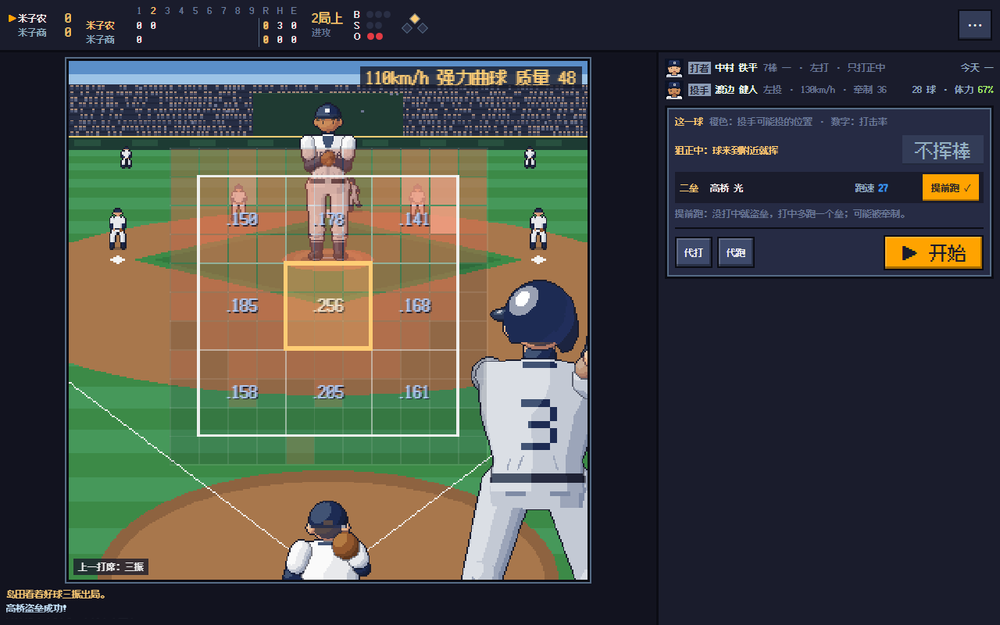

# 像素甲子园：监督之路

一个以日本高中棒球为题材的**像素风棒球游戏**。你是一所高中棒球部的监督：平时时间自己流逝，球队按你定下的方针训练、成长；比赛日由你**一球一球地亲自指挥**——投球时选球种、在好球带网格上点要投的位置，打击时看着投手这一球的热区图选要打的那一格，结果由球员的能力和一点运气决定。目标是带着这支队伍站上甲子园。

### 👉 [点这里直接在浏览器里玩](https://yichics.github.io/AutoGame/games/pixel-baseball/dist/)

> 本游戏收录在 [AutoGame 像素游戏厅](https://yichics.github.io/AutoGame/)（原仓库 [YichiCS/Pixel-Baseball](https://github.com/YichiCS/Pixel-Baseball)）。更新规则见仓库根目录的 `CONTRIBUTING.md`，版本记录见 [CHANGELOG.md](CHANGELOG.md)。



## 怎么玩

- **平时**：时间自动流逝（1 倍速下游戏里的一天约 1.5 秒；空格暂停 / 继续，数字键 1～4 切换 1x / 2x / 4x / 10x），球队按「方针」训练。需要你决定的事出现时会自动暂停；关掉页面期间也会补上训练（最多 120 天，遇到要亲自指挥的比赛会停下）。
- **比赛日**：要亲自指挥的比赛会打开比赛画面（默认是正式比赛，可以在「方针」里改成全部、只有重要比赛或都不指挥）。开赛前确认打线、选先发投手，也可以直接交给教练出结果。
- **每一球都由你决定**：投球时点网格瞄准、按「▶ 投球」；打击时点要打的一格、按「▶ 开始」（空格键也行）；演出中再按空格可以跳过。手机上一屏就能操作完，不用上下滚动。
- **自动指挥**：每一球都亲自指挥 / 关键时刻才问我 / 只指挥进攻 / 只指挥防守 / 全部交给教练，比赛中随时切换（右上角 ⋯ 菜单）；还有「这个半局交给教练」「直接打完整场」。演出速度 1x / 2x / 4x。
- **阵容**：在「阵容」页排 9 棒的人和守位、先发顺位、下一场先发。谁都能守任何位置、谁都能投。
- **存档**：每 15 秒自动保存在浏览器本地；比赛打到一半关掉页面，下次会从同一球继续。右上角「⚙ 设置」可以导出 / 导入，从游戏厅打开时还有「返回游戏厅」「存档管理」。

## 比赛：一球一球地指挥

画面是长焦机位：投球时从投手背后看，打击时从捕手背后看，中间是放大的瞄准网格——**11×11 格，中间 9×9 是好球带，外面一圈是坏球区**。格子里的数字是这名打者在九宫格每一格的打击率（红的是热区）。

### 投球
- **选球种**：每个球种显示这一球的质量（0-100：直球看球速、球威、控球，变化球看等级和球威；累了会下降）。
- **点网格瞄准**：实际落点按控球、球种质量和体力在目标附近随机散布。直球是圆圆的一团；变化球顺着变化方向拉长、偏向变化的一侧（变多了跑得更远），还可能「失投」——没变化，留在好打的位置；蝴蝶球乱飘。偶尔谁都会投歪。选好目标后网格上会显示这一球大概会落在哪。
- **离垒警告与牵制**：对方跑者离垒很大时会提示。牵制成功率看投手的牵制能力（控球、守备、肩力、沉着，左投手、「牵制○」「快速投球」加分）、离垒大小、跑者是不是本来就想跑；离垒正常的人很难抓。每个打席最多牵制 3 次。
- 换投、守备替换。

### 打击
- **热区图**：每一球之前能看到投手这一球打算投哪里（橙色，可能有好几处——投手也在和你猜）。
- **选要打的一格**：球来到那一格附近就挥棒，离得越近越容易打中、打得越扎实；别处的球放过（两好球后好球带里的球会勉强碰一碰）。也可以「不挥棒」。落点那一格的打击率、球的质量决定打中以后的结果。
- **跑者提前跑**：没打中就是盗垒，打中了多跑一个垒；但对方投手看穿了会牵制。
- 代打、代跑。

对手也会读你：投手按球数、你的冷热区、自己各球种的质量和之前的打席定下每一球的打算；打者看着投手的打算选格子。结果只看能力和概率——同样的选择，有时被接杀，有时飞出全垒打。

## 球队与球员

- **一年的流程**：4 月新生入部 → 春季县大会（→ 春季地区大会）→ 6 月梅雨、期末考试 → **7 月夏季县大会**（冠军去 **8 月甲子园**）→ 夏天结束三年级引退、任命主将、校方评价 → 秋季县大会 → 秋季地区大会（冠军去**明治神宫大会**，成绩好的 1 月入选**春季选拔**）→ 10 月职业选秀会议 → 冬训（12～3 月禁止对外比赛）→ 3 月毕业典礼、春季选拔。每周六有练习赛。
- **15 项能力，0-100**（击球、力量、选球眼、跑速、肩力、守备、捕球、触击、跑垒、球速、控球、耐力、球威、精神、体质；球速另附 km/h），每项都有隐藏的能力上限；弹道 1～4。球员列表和详情里标出最近两周涨了多少。
- **总评与位置**：每个人在 9 个位置上都有一个评价（投手看投球，其他位置看打击和这个位置的守备，左投守捕手和二三游吃亏），评价最高的位置就是他最适合的位置，那个评价就是**总评**。谁都能守任何位置、谁都能投；投手打击也不会差到断层，野手也会投——练得多的一边强一些，另一边每天也分到两成练习。
- 潜力、成长型（早熟 / 普通 / 晚成）、9 种性格、练习态度、调子、疲劳、干劲、信赖、学力、人气、伤病（重伤时选择手术或保守治疗）、49 种特殊能力，都在比赛和育成中实际生效。训练得到五种经验（力量 / 敏捷 / 技术 / 变化 / 精神），按每个人的「培养方针」自动加点；比赛也会给经验。
- **21 种变化球**：二缝线、卡特球、伸卡球、内飘球、滑球、高速滑球、横扫球、纵向滑球、曲球、慢速曲球、指关节曲球、强力曲球、指叉球、快速指叉球、变速球、圈指变速球、掌心球、下沉球、螺旋球、蝴蝶球、陀螺球。各有球速、挥空、滚地、控球难度、暴投风险和变化方向；投手最多掌握 6 种，等级 1～7，练到高等级有机会开发出独创的**魔球**。
- **方针与设施**：训练方针、强度、学业、比赛风格、投手起用、起用方针、招生方针；用部费修建球场、打击笼、投球练习场、力量训练室、室内练习场、医务室、影像分析室、宿舍。
- **事件（90 多种）**：低潮、开窍、恋爱、夜练、学新球种、改侧投、转守位、二刀流、神秘的老人、宿敌、赞助、OB 回校……每个选项下面标出可能的结果（部费、干劲、能力、受伤的概率……），可以按 12 个类别托管。
- **监督生涯**：5 种出身、8 项监督能力、名声、校方目标与评价、其他学校的邀请（跳槽）、解任、27 项成就、职业 OB 的后续发展。

## 发布

本游戏随 AutoGame 一起发布：GitHub Pages 直接发布 AutoGame 仓库 main 分支的根目录，**不会替你构建**，所以修改源码后要运行 `npm run build`，把新的 `dist/index.html` 一起提交。AutoGame 的检查（`node scripts/check.mjs --build`，GitHub Actions 每次推送都会跑）会重新构建并确认提交的 `dist/index.html` 是最新的。更新流程见仓库根目录的 `CONTRIBUTING.md`（分支名 `pixel-baseball-v<版本号>`）。

构建结果是一个资源全部内联的 HTML 文件，末尾引入游戏厅的接入脚本 `../../../hub/dock.js`（不显示任何东西，只提供「返回游戏厅」「存档管理」的地址）；单独拿出来放在任何路径下也能运行（设置里就没有这两个按钮）。

## 开发

需要 Node.js 20 以上。

```bash
npm install
npm run dev        # 开发服务器 http://localhost:5173 ，保存后自动刷新
npm run build      # 生成单文件 dist/index.html
npm run typecheck  # TypeScript 类型检查
```

无界面测试：

```bash
node scripts/run-ts.mjs tests/live.ts 20               # 亲自指挥的比赛：每一球随机下指令打完整场，按记录重演（含中途读档、交给教练打完）必须一模一样
node scripts/run-ts.mjs tests/idle.ts 10 30 7 1 all    # 挂机 10 年（县 id 30 = 鸟取，种子 7，选第 2 所学校，全部托管）
node scripts/run-ts.mjs tests/calib.ts                 # 按需生成的对手名单与战力评分是否一致
node scripts/run-ts.mjs tests/balance.ts 42 400        # 比赛引擎统计（打率、三振率、得分……）
node scripts/run-ts.mjs tests/fuzz.ts 1500             # 比赛引擎模糊测试（随机指令 + 不变量检查）
node scripts/run-ts.mjs tests/mismatch.ts 60 30        # 实力悬殊的比赛（检查比分有没有失控）
node scripts/run-ts.mjs tests/spread.ts                # 各球种落点散布的方向
node scripts/run-ts.mjs tests/rating.ts                # 总评校准：同样素质的投手型和野手型总评差不多
node scripts/run-ts.mjs tests/migrate.ts <存档.json>    # 旧存档迁移
node scripts/run-ts.mjs tests/growth.ts                # 球员成长曲线
```

### 目录结构

```
src/
  core/        游戏逻辑（与界面无关，可在 Node 中运行）
    types.ts      数据结构            state.ts     全局状态、动态、大事记
    calendar.ts   日历（一年 360 天）  sim.ts       每日 tick、年度流程、离线进度
    daily.ts      训练、疲劳、伤病、调子
    season.ts     大会日程与晋级链     tournament.ts 淘汰赛
    matchday.ts   本校比赛：组队、自动比赛、写回结果
    live.ts       亲自指挥的比赛：一球一球推进、比赛专用随机数、指令记录与读档重演
    lineup.ts     自定义阵容与比赛当天的自动补位
    world.ts      本县学校（存档）、外县学校与对手名单（按种子生成）
    player.ts     球员生成            growth.ts    经验与成长、球种学习
    attrs.ts      能力评价            team.ts      自动排阵与战力
    recruit.ts    招生                draft.ts     选秀与毕业
    economy.ts    部费与设施          career.ts    监督、目标、跳槽、成就
    queue.ts      决策队列与托管      events/      事件（系统 / 球员 / 球队与学校）
    newgame.ts    新游戏              save.ts      存档
  sim/         比赛引擎（match.ts 逐球模拟、pitching.ts 网格 / 球种质量 / 散布 / 九宫格打击率 / 挥棒、brain.ts 每一球的打算与教练、ai.ts 换人与战术、quick.ts 快速模拟）
  render/      像素绘图（stage.ts 长焦机位与瞄准网格、figure.ts 人物、field.ts 俯视球场、scene.ts 练习场、portrait.ts 头像）
  ui/          Preact 界面（App、match/ 比赛画面、tabs/ 各页、Modals 弹窗、loop.ts 主循环）
  data/        名字、都道府县、特殊能力、球种
tests/         无界面测试
scripts/       构建脚本
assets/fonts/  像素字体
dist/          构建产物（单文件 index.html，要提交）
docs/          截图
game.json      游戏厅清单：名字、版本、封面、构建命令、存档位置
save-adapter.js 给游戏厅用的存档适配器
CHANGELOG.md   更新日志
```

## 致谢与许可

- 代码：MIT License（见 `LICENSE`）。
- 字体：[Fusion Pixel Font（缝合像素字体）](https://github.com/TakWolf/fusion-pixel-font)，SIL Open Font License 1.1（见 `assets/fonts/OFL.txt`）。
- 游戏中的人名、校名、企业名、职业球队名均为虚构，与现实无关。
