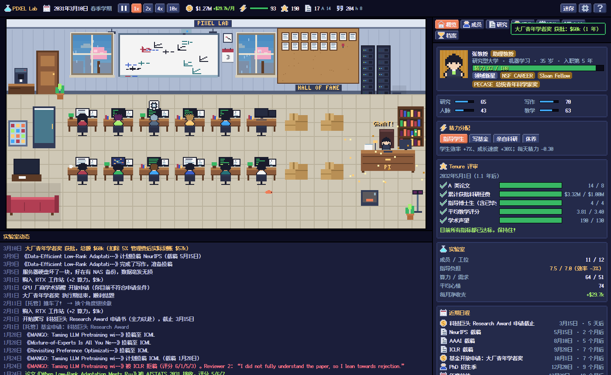

# 科研模拟器 · Research Simulator

一个像素风的桌面挂机小游戏：你从一名**计算机方向的博士生**开始，读完博士凭成果找教职，然后作为 PI 从一间空荡荡的实验室开始，申请基金、招学生、发论文、熬过 Tenure / “非升即走”，一路冲向 Fellow、院士，甚至图灵奖。

### 👉 [点这里直接在浏览器里玩](https://yichics.github.io/AutoGame/games/research-simulator/)

> 本游戏收录在 [AutoGame 像素游戏厅](https://yichics.github.io/AutoGame/)（原仓库 [YichiCS/Research-Simulator](https://github.com/YichiCS/Research-Simulator)）。更新规则见仓库根目录的 `CONTRIBUTING.md`，版本记录见 [CHANGELOG.md](CHANGELOG.md)。



## 怎么运行

**方式一：在线玩（零安装）**

打开 **<https://yichics.github.io/AutoGame/games/research-simulator/>** 即可（推荐 Chrome / Edge），也可以从 [游戏厅首页](https://yichics.github.io/AutoGame/) 进入。存档自动保存在浏览器本地，下次打开接着玩；游戏厅的「存档中心」可以导出 / 导入存档（单独或和其他游戏一起）。

**方式二：本地打开**

下载仓库后双击 `index.html`（本地打开时不显示返回游戏厅的悬浮标签）。

**方式三：桌面版（Electron）**

需要先安装 [Node.js](https://nodejs.org/)，然后在仓库目录里：

```bash
npm install
npm start
```

桌面版额外支持：

- **迷你模式**：窗口缩到屏幕右下角并置顶，适合一边干活一边挂机
- 需要你做决定而窗口不在前台时，任务栏图标会闪烁
- 窗口最小化后游戏照常运转
- 界面缩放（设置里调整）

## 玩法

- **两种开局**：
  - 从博士一年级开始：你是导师实验室里的一名博士生（导师分大牛 / 中坚 / 青年 / 放养四种），要选课题、过资格考试和开题、决定要不要去实习、帮导师干活、带学弟学妹、去开会认识人……读完博士带着论文、推荐信和人脉去找教职。能拿到哪些学校的 offer、带着什么背景开实验室、你的初始能力，都由读博的经历决定；没拿到满意的 offer 也可以先去做博后或去业界，两年后再试。
  - 直接当 PI：跳过读博，自己选学校和背景，从刚入职的助理教授开始。
- **时间自动流逝**。实验室会自己运转：学生们选题 → 构思 → 做实验 → 写论文 → 投稿 → 审稿。一个课题要做几个月到一年多：能力越强越快，顶尖的学生在资源充足的组里三四个月出一篇，普通学生要八九个月。被拒的论文要先按审稿意见修改才能改投，改稿会占用负责人的精力——被拒的论文堆多了，新课题就做得很慢（实在不想改了可以直接挂 arXiv）。
- **关键节点自动暂停**，等你做决定：基金申请季、招生季、排课、学生想去实习 / 想退学 / 被大厂挖走、撞车、Rebuttal、DDL 冲刺、考核……共 60 多种事件。
- **两种职业体系**：
  - 北美 Tenure-Track：NSF CRII / CAREER / CORE、企业捐赠、PhD 招生季，第 6 年 Tenure 评审
  - 中国 预聘-长聘：国自然青年 / 面上 / 优青 / 杰青、横向课题、夏令营推免 + 考研复试，3+3 “非升即走”
- **三级研究方向**：13 个领域（机器学习、视觉、NLP、系统、安全、理论、HCI、机器人、数据库、体系结构、软件工程、图形学、计算机网络）→ 90 多个方向 → 近 400 个子方向（比如 机器学习 → 大语言模型 → 长上下文）。领域决定会议和引用水平；实验室有一个核心方向，方向积累提高论文质量；小组按子方向设立，热度、算力需求、论文标题和学生的兴趣都细到子方向。热点会落在某个子方向上，偶尔整个方向一起升温。
- **投稿**：参考 [ccfddl](https://ccfddl.com) 收录了 230 多个会议和期刊，等级按 CCF 推荐目录（A / B / C，不在目录里的按业内认可度定级），截稿日期取最近一届，有的一年多轮、有的隔年举办。很多会议跨方向收稿：NeurIPS / ICLR 收视觉和 NLP，AAAI 收整个 AI，MICCAI 只收医学影像，S&P 也收大模型红队的论文，PLDI 收程序分析……论文按它的子方向列出能投的地方；「研究」页有投稿日历。
- **论文质量**取决于学生的能力、你的研究和写作能力、算力、方向积累；A 类会议门槛高、审稿有运气，而且整个领域的门槛每年都在上涨。
- **学生属性**：研究能力（想法、编程、写作、数理）+ 软实力（协作、表达、抗压），再按权重算出一个**总评**（S / A / B / C / D）。各项能力都在 0～100 上，大致呈正态分布：博士生候选人一般 61～78 分，硕士生 52～69 分，进组的本科生 40～60 分（学校越好、实验室名气越大，候选人越强）。数理让想法更新颖、实验更扎实；协作让帮忙出力更多、当组长时组员成长更快；表达让 Rebuttal 更有说服力、更容易拿 Oral 和最佳论文、毕业找工作更顺；抗压让心情不容易垮、被拒稿也扛得住。
- **成长**：每个学生有一个**潜力**（0～10）。每年年底，先从「均值 = 潜力」的正态分布里抽出这一年的状态 t（最高 10），再给七项能力各自独立抽一个 0～t 之间的成长值（正态分布，平均 t/2）加上去，最后重新算总评；这一年入组不满一年的按时间折算。年度总结里能看到这一年谁长了多少，成员档案里有潜力和每一年的成长。年轻的本科生潜力普遍更高，博士后、青年教师已经比较定型。带教环境会让 t 偏高或偏低：把精力放在指导学生上、每周开组会、有组长带、交给青年教师带都更好；单干、指导负担太重、心情差、没有工位、当助教都会拖后腿。大致结果：博士生入学时 70 分上下，毕业时 80 出头，最好的能到 90 以上，组里 S 级的学生不到一成；本科生在组里跟着做一年半，毕业时三到六成能达到硕士生的水平（硕士候选人的平均水平），一成左右能达到博士生的水平（博士候选人的平均水平）；硕士生毕业时大约四分之一能到博士生的水平。去开会会练表达、被拒稿会更扛打这些小事也会让能力涨一点。
- **时间检验奖（Test of Time）**：每年年底，各个会议会给十年前那一届里影响最大的论文颁奖。引用要达到同档次一般论文的 9 倍以上才有机会，越高越有希望，最佳论文再加一点；A 类会议的奖声望 +12，B 类 +5，论文还会因此多被引用。很难拿——一个做得很好的实验室干二十五年，平均也就一个左右。获奖论文在荣誉墙上是蓝框，和最佳论文（金框）一起排在最前面。
- **署名**按每个人的实际工作量排：一作、共同一作、二作……你是通讯作者。博士毕业看一作论文，署名不公会闹矛盾。
- **统计**：「统计」页有引用量曲线、h-index 曲线、累计发表曲线、每年发表（按 A / B / C 堆叠），以及论文都发在了哪些会议 / 期刊、每个会议的投稿次数和中稿率（按等级汇总）。
- **界面**：每一页都分了栏，比如「研究」分成课题 / 投稿 / 论文 / 投稿日历，「成员」按博士 / 硕士 / 本科 / 其他 / 已离开分开，「经费」分成收支 / 账本 / 基金 / 横向，会记住你上次看的是哪一栏。已发表的论文可以按类别（A / B / C / Workshop / 预印本）、荣誉（最佳论文、时间检验奖、Oral、出圈各自单独筛）、会议、作者、年份筛选，按最新 / 最早 / 引用最多排序。界面一直在实时刷新，但鼠标正指着的按钮不会被上面变长变短的内容挤走，顶栏的暂停、倍速按钮也不会随日期左右挪动。
- **带学生**：把实验室分成几个子方向小组（可以都在核心方向下，也可以跨到别的方向），给每个学生分组（最多两个）、任命组长、把服务器专门分给某个组。每 3 个人才能撑起一个小组（同时受实验室空间限制），免得全是一两个人的“光杆组”。可以开「自动分组」：兴趣优先（为想做同一个子方向的学生成立小组，学生调到最对口的组）或热度优先（在最热门的子方向成立小组，把人分进去），每月自动调整，只剩一两个人的组会被合并掉。组长可以自动任命：组里资历够的人里，博士后 / 青年教师优先，同等资历选总评最高的。小组成员只做小组的方向，但组员之间互相帮忙：组里人越多做得越快（最多 +20%，有组长再 +5%），帮得多的组员会挂名；不在任何小组的学生单干，可以做自己最想做的方向，但没有互助和组长指导，效率和成长都打折扣。学生有自己的专业、爱好、口头禅、职业理想和最想做的子方向（做正好想做的子方向最开心，同一方向下的也有一半效果），师生之间有信任度。和学生有关的弹窗（想读博、想退学、实习、被挖、选题、毕业……）都会附上 TA 的总评、各项能力、心情、信任、论文、小组和毕业去向预估，方便你做决定。学生的兴趣会变：时不时迷上别的方向，你可以支持 TA、为 TA 开个新组，或者劝 TA 继续深耕（成功率看信任和抗压）。每做完一个课题都会来找你商量下一个：接着做、调到别的组、为 TA 新开一个组、先去帮同门，或者干脆让 TA 自由选方向；达到要求后由你安排毕业答辩。
- **工位**：实验室可以一直扩建：从小实验室一路扩到「研究中心」（32 个工位），之后还能一期一期接着扩，每期多 8 个工位，费用和声望要求越来越高、还要施工一段时间（30 天起，越往后越久，最长 180 天）。每层楼放 16 个工位，更大的实验室分成好几层，画面左上角切换楼层（楼层多了用「◀ 3F/9 ▶」翻页）。有固定工位的人效率正常，没有工位的只能找地方凑合（效率 -15%，本科生、访问学生 -8%，心情也慢慢变差）。工位不够时谁先坐，看方针里的「工位分配顺序」（默认先到先得：已经坐下的人不会被挤掉，空出来的工位按身份和资历分），你也可以在成员卡片上亲自「给工位」「收回工位」。
- **小导师**：当上大导师（正教授或声望够高）以后，会有青年教师带着自己的学生和一笔经费加入你的团队。青年教师自己做课题、可以当组长，也帮你带学生：你可以指定每个学生由你还是哪位青年教师来带——交给青年教师的学生不占你的指导负担、成长更快，论文上会署导师的名字，但每位青年教师能精心带的学生有限。青年教师做出成绩后会拿到别的学校的教职出去独立，你可以让学生跟着走、留下由你来带，或者花钱挽留。
- **跳槽**：入职满一年后可以在「概览」页悄悄投简历，也会有学校主动来挖你。offer 的档次、职称、启动经费和实验室大小看你的声望和成果——够新学校的长聘标准就能直接带着长聘（甚至升一级）过去。offer 可以拿去和学院谈留任经费；接受之后要决定带谁走：每个人愿不愿意跟你走不一样（博士生、博士后多半愿意，硕士生、本科生大多留在原校），不愿意的可以劝一劝。在研的基金、服务器和设施都跟着你走，搬家的一个多月里大家效率打折扣。
- **经营**：经费、算力、设施（咖啡机、白板墙、实验室猫、鱼缸、乒乓球桌、跑步机……二十多种，都会出现在画面里；实验室有两层楼时，鱼缸、懒人沙发、冰箱、乒乓球桌、跑步机这些放在二楼）、实验室扩建、PI 精力。
- **经费来源**：纵向基金（后期还有 NSF 研究中心、牵头重点研发计划项目这样的大项目）；企业合作 / 横向课题——企业会主动找上门，分技术咨询、联合研发、大型项目三种，声望越高给的钱越多，实验室人越多能同时接得越多、对科研的影响也越小，到期可能续约，名气大了还会有大公司来共建联合实验室；学校配套——拿到人才称号、晋升、当选 Fellow / 院士时学校会给一笔配套经费；再加上捐赠、技术转让等。
- **算力像水**：每个在做实验的课题是一根水管，**实验速度 = 流进来的算力 / 需求**，没有上下限——水越多跑得越快，水越少跑得越慢；大家自己的电脑也算一点水，所以没有服务器也不至于完全跑不动。不过算力只加速实验里「跑计算」的那部分：机器学习、视觉、NLP 几乎全是算力；系统、网络这些方向的实验主要靠人搭环境、调系统，算力再多也只能加速其中跑计算的那一截。共享的算力先流给最缺水的实验，填平了再一起往上涨。服务器可以分给某个小组专用：不用排队、环境配好，一台顶 1.25 台，但闲着也不外借。「设施」页能看到每个实验的水管。GPU 一代代更新，模型需求每年增长约 15%。
- **方针**：精力分配、工作强度（佛系 / 内卷）、组会频率、选题倾向（深耕积累 / 追热点 / 尊重兴趣）、学生选题要不要来问你、投稿策略、会议出差（第一作者去 / 只派一个代表 / 你也一起去 / 都不去；只派代表时同一个会议同一年只去一个人，选作者里中稿最多的、一样多看资历）、组长任命、工位分配顺序（先到先得 / 职位优先 / 能力优先 / 资历优先）、托管。
- **出路与到期**：本科生想读研、硕士生想读博、博士生申请答辩、博士后合同到期时怎么处理，可以在方针里按身份定规则——跟随托管、每次问我，或者自动处理（比如本科生按水平读博 / 读硕、博士生都先延期一年再答辩、博士后一直续约或续约一次再放走）。延期、续约按每个人已经延期 / 续约过几次算，自动处理的结果记在动态里。博士最多读 8 年（再延期一年就会超过的，只能答辩），博士后可以一直续约。
- **招人**：「成员」页可以随时招本科生、发博士后招聘广告；打开「持续招本科生」「持续招博士后」后，到了能再招的时候自动发起下一轮，不管工位够不够（经费偏紧时动态里提醒一句）。研究生招生季、本科生、博士后的候选人名单可以在方针「招人名单」里设成「从高到低招满」：按总评从高到低录用，直到名额或经费用满；默认还是由你来挑。
- **招生面试**：候选人可以按总评、任意一项能力、潜力或接受 offer 的概率排序，再点一次反过来排（没面试的按能力范围的中间值算，潜力面试后才知道）。
- **托管**：可以逐类决定哪些事交给托管（按推荐选项处理）、哪些每次问你——学生选题和分组、学生的请求和去留、学生生活、招人、研究生招生、论文和审稿、投稿目标、基金申请、小组里的事、学术机会、企业合作 / 横向、跳槽机会、排课、杂事、意外和危机、通知、年度总结、自动添置算力，一共 18 类；也可以一键套用「全部问我」「小事托管」「全部托管」三个预设，全部托管就是真正的挂机。考核结果和跳槽时带谁走一直由你来定。学生到期去留、招人名单还可以在方针「出路与到期」「招人名单」里按身份单独设置（优先于这里的分类）。
- 画面里的天色跟随你电脑上的**真实时间**，窗外的四季跟随**游戏月份**。

## 操作

| 操作 | 说明 |
| --- | --- |
| 空格 | 暂停 / 继续 |
| 数字键 1~4 | 切换速度（1x / 2x / 4x / 10x） |
| 点击画面里的学生 | 跳到成员页查看 TA |
| 点击荣誉墙 | 查看 A 类论文 |
| 顶栏「迷你」 | 只保留实验室画面 |
| 设置 | 音效、离线进度、导出 / 导入存档 |
| 屏幕左边缘的小标签 | 返回游戏厅、跳到存档管理（可上下拖动） |

关掉游戏期间，实验室会按 1 倍速继续运转（最多 120 天，遇到需要决定的事会停下），可以在设置里关闭。

## 项目结构

```
index.html            入口（末尾引入游戏厅的悬浮标签 ../../hub/dock.js）
game.json             游戏厅清单：名字、版本、封面、存档位置
save-adapter.js       给游戏厅用的存档适配器（显示存档详情、导入时不触发离线快进）
CHANGELOG.md          更新日志
css/style.css         像素风界面
js/core/              游戏逻辑（与界面无关，可以在 Node 里跑）
  state.js            存档结构、日期换算
  systems.js          成员、课题、投稿审稿、引用、算力、财务
  career.js           基金、招生、教学、考核、毕业、年度总结
  groups.js           课题组（子方向）、服务器分配、选题商量、毕业规划
  phd.js              博士阶段：导师实验室、你的里程碑、求职、转成 PI
  sim.js              每日 tick、决策队列、托管
js/data/              数据：研究方向（areas.js）、会议期刊（venues.js）、地区（基金/考核）、特质/设施/成就、事件、博士阶段（导师类型、博士生的事件）
js/ui/                像素画（程序化绘制）、场景、音效、界面
electron/             桌面版外壳
tools/simulate.js     无界面数值模拟，用来调平衡
```

想改数值的话，大部分参数都在 `js/data/` 里（会议截稿、基金金额和难度、考核要求、设施效果……）。改完可以用模拟器快速看看效果：

```bash
node tools/simulate.js us ml 1 8 5 smart   # 北美 / 机器学习 / 研究型大学 / 8 年 / 5 局 / 认真玩
node tools/simulate.js cn sys 0 8 5 lazy   # 中国 / 系统 / 顶尖高校 / 全程托管
```

## 致谢

- 像素字体：[Fusion Pixel Font](https://github.com/TakWolf/fusion-pixel-font)（SIL Open Font License 1.1，见 `assets/fonts/OFL.txt`）
- 配色参考 Sweetie 16 调色板

会议截稿日期、基金名称等参考了真实世界，但所有数值都是游戏化的，请勿当真。
